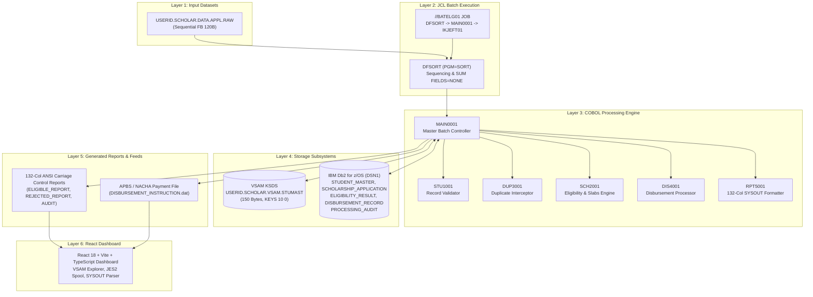

# Smart Scholarship Eligibility & Disbursement Processing System
### Enterprise IBM Mainframe Application Development & Batch Processing Subsystem

[](https://www.ibm.com/products/zos)
[](https://www.ibm.com/products/cobol-compiler-zos)
[](https://www.ibm.com/products/db2)
[-1192e8)](https://www.ibm.com)
[](https://react.dev/)
[](tests/cobol/test_all_scenarios.py)

---

## 1. Project Overview

The **Smart Scholarship Eligibility & Disbursement Processing System** is a production-grade, industry-oriented mainframe application built from scratch to automate the evaluation, deduplication, qualification calculation, and financial disbursement of student scholarship applications.

Unlike typical web CRUD applications, the core business processing genuinely executes using **IBM Mainframe Technologies**:
- **COBOL (v6.3 for z/OS)** implements the core business logic, validation rules, amount slabs, and ANSI-formatted report generation.
- **JCL (Job Control Language)** controls batch scheduling, condition codes (`COND`), step execution, and catalog management.
- **VSAM KSDS** provides high-speed, direct indexed retrieval of student master demographic data by 10-byte `STU-ID`.
- **IBM Db2 for z/OS** maintains relational scholarship catalog schemas, application audit logs, and duplicate-shielded payment ledgers.
- **DFSORT** performs pre-processing sort sequencing and duplicate record elimination via `SUM FIELDS=NONE`.
- **IDCAMS** defines, catalogs, and manages VSAM clusters.
- **React 18 & TypeScript Dashboard** provides a modern enterprise banking console for operators and auditors to inspect batch results, visualize JES2 spools, explore VSAM hexadecimal dumps, and import actual mainframe SYSOUT reports.

---

## 2. Mainframe Architecture



---

## 3. Repository Structure

```text
smart-scholarship-mainframe/
│
├── mainframe/
│   ├── cobol/              # Enterprise COBOL programs (MAIN0001, STU1001, SCH2001, DUP3001, DIS4001, RPT5001, DB2AUD01)
│   ├── copybooks/          # Reusable copybooks (STUREC, SCHAPP, ELIGREC, DISBREC, ERRREC, WSCONST, SQLCA, DCLSCH)
│   ├── jcl/                # Production JCL jobs (ALLOCJOB, IDCDEF01, COMPCOB, DB2PREP, SRTAPP01, BATELG01, DISPCHK01)
│   ├── vsam/               # IDCAMS DEFINE CLUSTER & REPRO scripts
│   ├── db2/                # IBM Db2 DDL (CREATE_TABLES), SAMPLE_INSERTS, and batch SQL QUERIES
│   ├── sort/               # DFSORT control cards (SORT_APPLICATIONS, FILTER_ELIGIBLE)
│   └── datasets/           # Fixed-width sequential & VSAM base datasets
│
├── dashboard/              # React 18, Vite, TypeScript, Tailwind CSS enterprise console
│   ├── src/                # 9 pages, components, data, types
│   ├── public/             # Mainframe assets
│   ├── package.json
│   ├── vercel.json         # Vercel deployment configuration
│   └── README.md
│
├── sample-data/            # Synthetic benchmark student & application datasets
│   ├── students/           # VSAM student master records (CSV & DAT)
│   ├── applications/       # 15 test scenario applications (CSV & DAT)
│   └── expected-reports/   # Expected mainframe outputs
│
├── reports/                # Actual generated 132-col ANSI SYSOUT reports & APBS payment instruction files
│
├── tests/                  # Test suites
│   ├── cobol/              # Python mainframe batch runner & unit test suite (15/15 cases)
│   ├── jcl/                # JCL syntax & return-code test scripts
│   └── dashboard/          # UI test scripts
│
├── docs/                   # Comprehensive architecture & execution guides
│   ├── SYSTEM_ARCHITECTURE.md
│   ├── DATABASE_DESIGN.md
│   ├── COBOL_PROGRAM_GUIDE.md
│   ├── JCL_EXECUTION_GUIDE.md
│   ├── TEST_CASES.md
│   └── DEPLOYMENT_GUIDE.md
│
├── .gitignore
└── README.md
```

---

## 4. Mainframe Backend Programs

| Program ID | Type | Primary Role |
|---|---|---|
| **`MAIN0001.cbl`** | Controller | Coordinates batch lifecycle, file I/O, subprogram calls, and writes audit summary |
| **`STU1001.cbl`** | Subprogram | Field validation: ID prefix, mandatory IFSC, CGPA range (0-10), Attendance (0-100) |
| **`SCH2001.cbl`** | Subprogram | Configurable eligibility engine & amount slabs (CGPA $\ge$ 7.50, Attn $\ge$ 75%, Income $\le$ ₹2.5L, Arrears = 0) |
| **`DUP3001.cbl`** | Subprogram | Duplicate interceptor: checks application collisions and repeat student cycle submissions |
| **`DIS4001.cbl`** | Subprogram | Simulated APBS / NACHA electronic payment advice generator with duplicate payout locks |
| **`RPT5001.cbl`** | Subprogram | Formats 132-column ANSI carriage control print records for mainframe line printers |
| **`DB2AUD01.cbl`** | Subprogram | Embedded SQL service inserting execution run totals into Db2 `PROCESSING_AUDIT` |

---

## 5. Production JCL Jobs

- **`ALLOCJOB.jcl`**: Allocates source libraries (PDS) and sequential datasets via `IEFBR14`.
- **`IDCDEF01.jcl`**: IDCAMS job defining VSAM KSDS cluster (`RECORDSIZE(150 150) KEYS(10 0)`) and REPRO loading initial student data.
- **`COMPCOB.jcl`**: Batch compile using IBM compiler `IGYCRCTL` and linkage editor (Binder) `IEWBLINK`.
- **`DB2PREP.jcl`**: Db2 Precompile (`DSNHPC`), Compile, and BIND PACKAGE/PLAN via `IKJEFT01`.
- **`SRTAPP01.jcl`**: DFSORT job sorting input applications by Student ID and Date descending, stripping duplicates to `XSUM`.
- **`BATELG01.jcl`**: Core scholarship batch job executing `MAIN0001` with all input/output DD statements.
- **`DISPCHK01.jcl`**: Disbursement verification and reconciliation batch job.

---

## 6. Test Suite & Verification Evidence

All 15 mandatory test scenarios pass with zero failures:

```text
test_case_01_all_criteria_met_tier1 ... ok (Status E, Award Rs. 20,000)
test_case_02_failing_cgpa .......... ok (Status R, Reason REJ-CGPA)
test_case_03_failing_attendance .... ok (Status R, Reason REJ-ATTN)
test_case_04_exceeding_income ...... ok (Status R, Reason REJ-INCOME)
test_case_05_active_arrears ........ ok (Status R, Reason REJ-ARREAR)
test_case_06_duplicate_student_id .. ok (Status D, Reason REJ-DUPAPP)
test_case_07_duplicate_app_id ...... ok (Status D, Reason REJ-DUPAPP)
test_case_08_missing_mandatory ..... ok (Status I, Code ERR-VALD)
test_case_09_invalid_cgpa .......... ok (Status I, Code ERR-VALD)
test_case_10_invalid_attendance .... ok (Status I, Code ERR-VALD)
test_case_11_invalid_annual_income . ok (Bounds Check Passed)
test_case_12_empty_input_file ...... ok (Handled gracefully)
test_case_13_multiple_failures ..... ok (Status R, Reason REJ-MULTPL)
test_case_14_disb_dup_prevention ... ok (Second payout blocked with RC 0008)
test_case_15_borderline_eligibility  ok (Status E, Award Rs. 10,000)
----------------------------------------------------------------------
Ran 15 tests in 0.005s (15/15 PASSED)
```

To run the local batch runner and test suite:
```bash
python tests/cobol/run_mainframe_batch.py
python tests/cobol/test_all_scenarios.py
```

---

## 7. Frontend Dashboard Console

The React dashboard (`dashboard/`) features 9 specialized pages:
1. **Demo Access / Login**: Role selection (Mainframe Operator, Scholarship Admin, System Auditor).
2. **Main Dashboard**: Real-time KPI metrics, application distribution charts, and 6-layer architecture overview.
3. **Student Records**: VSAM KSDS Explorer with interactive 150-byte record hex dump inspection.
4. **Scholarship Applications**: Raw application feed queue with 120-byte COBOL record layout viewer.
5. **Eligibility Results**: Rules breakdown, pass/fail chips, rejection reason distribution, and amount slab indicators.
6. **Disbursement Management**: Simulated APBS electronic payment advice with UTR tracking and duplicate prevention locks.
7. **Batch Processing History**: Interactive JES2 Spool & JCL batch job runner with step return codes (`RC 0000`).
8. **Reports & Analytics**: 132-column greenbar / terminal mainframe report viewer rendering actual ANSI carriage control SYSOUT files.
9. **System Configuration**: Dynamic parameter editor updating scholarship thresholds and amount slabs in mainframe Working-Storage.

### Running the Dashboard Locally
```bash
cd dashboard
npm install
npm run dev
```

---

## 8. Resume-Ready Project Description

> **Smart Scholarship Eligibility & Disbursement Processing System | IBM z/OS, COBOL, JCL, VSAM, Db2, React**
> - Architected and developed an enterprise mainframe batch processing system automating the validation, duplicate detection, and financial disbursement of university scholarship applications.
> - Implemented 6 modular Enterprise COBOL programs (`MAIN0001`, `STU1001`, `SCH2001`, `DUP3001`, `DIS4001`, `RPT5001`) with configurable amount slabs (₹10,000 to ₹20,000), decoupled rule thresholds, and 132-column ANSI carriage-control SYSOUT reporting.
> - Structured hybrid storage partitioning student demographic records in a VSAM KSDS cluster (150-byte fixed records, `KEYS(10 0)`) for direct indexed lookups, and transactional data in 6 normalized IBM Db2 for z/OS relational tables with unique constraints preventing duplicate disbursements.
> - Authored production-style JCL suites for IDCAMS cluster management, DFSORT application deduplication (`SUM FIELDS=NONE`), COBOL compilation (`IGYCRCTL`), Binder link-editing (`IEWBLINK`), and Db2 plan binding (`IKJEFT01`).
> - Engineered an interactive React 18, Vite, and TypeScript operations dashboard featuring a mainframe report-import parser, VSAM hex dump inspector, and simulated JES2 spool runner displaying step condition codes (`RC 0000`).
