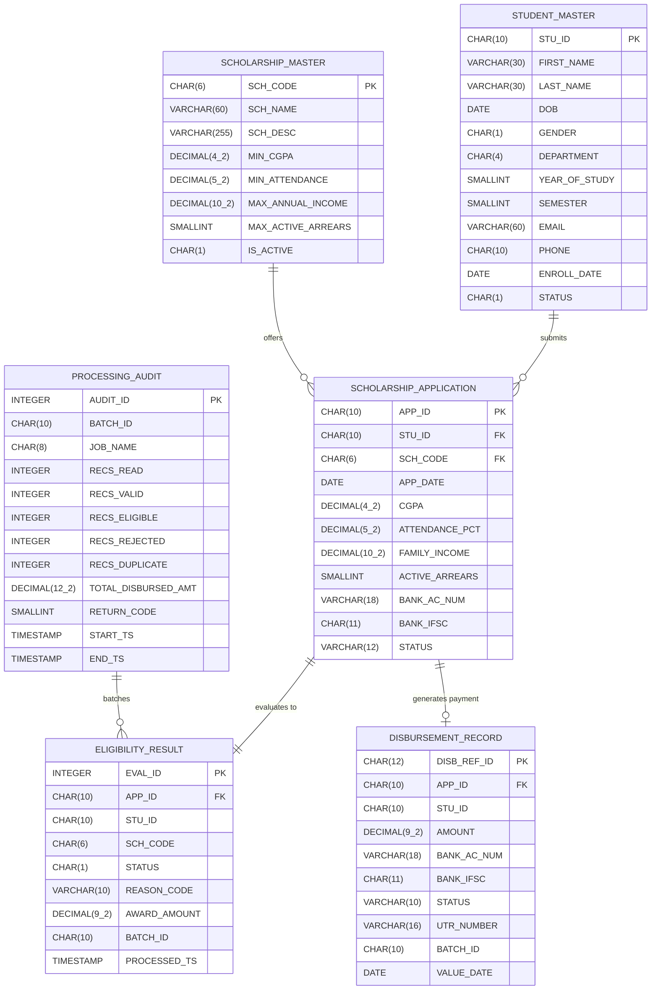

# Database Design & Storage Subsystems

## 1. Overview

The data tier of the **Smart Scholarship System** utilizes a hybrid architecture:
- **VSAM Key-Sequenced Data Set (KSDS)**: High-speed, low-overhead indexed direct access for student master demographic records.
- **IBM Db2 for z/OS (Relational Subsystem DSN1)**: Normalized relational tables with primary keys, foreign keys, indexes, check constraints, and transactional consistency.

---

## 2. VSAM KSDS Cluster Specification

- **Cluster Name**: `USERID.SCHOLAR.VSAM.STUMAST.KSDS`
- **Data Component**: `USERID.SCHOLAR.VSAM.STUMAST.KSDS.DATA`
- **Index Component**: `USERID.SCHOLAR.VSAM.STUMAST.KSDS.INDEX`
- **Record Format**: Fixed (150 bytes)
- **Primary Key**: `STU-ID` (Length: 10 bytes, Offset: 0)
- **Freespace**: `(15 10)` (15% CI, 10% CA freespace for splits)
- **Share Options**: `(2 3)` (Read-shared across multiple batch steps, single writer)

### Record Field Layout (`STUREC.cpy`)

| Field Name | COBOL Picture | Length | Start Pos | End Pos | Description |
|---|---|---|---|---|---|
| `STU-ID` | `PIC X(10)` | 10 | 1 | 10 | Primary Key (e.g., `STU2024001`) |
| `STU-NAME` | `PIC X(30)` | 30 | 11 | 40 | Student Full Name |
| `STU-DOB` | `PIC X(08)` | 8 | 41 | 48 | Date of Birth (YYYYMMDD) |
| `STU-GENDER` | `PIC X(01)` | 1 | 49 | 49 | Gender ('M', 'F', 'O') |
| `STU-DEPT` | `PIC X(04)` | 4 | 50 | 53 | Department Code (`CS  `, `IT  `, `ECE `) |
| `STU-YEAR` | `PIC 9(01)` | 1 | 54 | 54 | Year of Study (1 to 4) |
| `STU-SEMESTER` | `PIC 9(02)` | 2 | 55 | 56 | Semester (01 to 08) |
| `STU-EMAIL` | `PIC X(35)` | 35 | 57 | 91 | Institutional Email Address |
| `STU-PHONE` | `PIC X(10)` | 10 | 92 | 101 | Contact Telephone Number |
| `STU-ENROLL-DATE`| `PIC X(08)` | 8 | 102 | 109 | Enrollment Date (YYYYMMDD) |
| `STU-STATUS` | `PIC X(01)` | 1 | 110 | 110 | Status ('A'=Active, 'S'=Suspended, 'G'=Graduated) |
| `STU-FILLER` | `PIC X(40)` | 40 | 111 | 150 | Reserved for future mainframe expansion |

---

## 3. IBM Db2 Relational Schema

---

## 4. Referential Integrity & Constraints

1. **Unique Indexes**:
   - `IX_STU_EMAIL`: Enforces unique email per student.
   - `IX_DISB_APP_UNIQUE`: Enforces that no scholarship application can have more than one disbursement record, mathematically preventing double disbursement at the database layer.
2. **Composite Indexes**:
   - `IX_APP_STU_CYCLE (STU_ID, SCH_CODE)`: Rapid lookup for duplicate application detection.
   - `IX_STU_DEPT (DEPARTMENT, YEAR_OF_STUDY)`: Fast filtering for department award allocations.
3. **Check Constraints**:
   - `CK_APP_CGPA`: `CGPA BETWEEN 0.00 AND 10.00`
   - `CK_APP_ATTN`: `ATTENDANCE_PCT BETWEEN 0.00 AND 100.00`
   - `CK_ELIG_STATUS`: `STATUS IN ('E', 'R', 'D', 'I')`
   - `CK_DISB_STATUS`: `STATUS IN ('PENDING', 'PROCESSED', 'FAILED', 'HOLD')`
