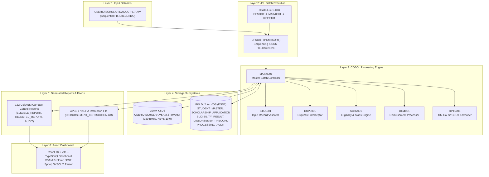

# System Architecture & Enterprise Integration Guide

## 1. Architectural Overview

The **Smart Scholarship Eligibility & Disbursement Processing System** is designed as a hybrid enterprise mainframe architecture, separating high-volume batch computation from modern web visualization.

The core business logic, data persistence, indexed record retrieval, deduplication, and financial calculation are implemented strictly in **IBM Enterprise COBOL for z/OS**, running as batch jobs automated via **JCL (Job Control Language)** on **IBM z/OS**. Data storage is partitioned between **VSAM Key-Sequenced Data Sets (KSDS)** for indexed student demographic lookups and **IBM Db2 for z/OS** for relational scholarship schemas, financial ledgers, and audit trails.

---

## 2. Six-Layer Architectural Separation

| Layer | Responsibility | Mainframe Technology | DCB / Parameters |
|---|---|---|---|
| **Layer 1: Student Input Files** | Raw application feed submitted by departments or university admissions | IBM z/OS Sequential Data Set | `RECFM=FB, LRECL=120, BLKSIZE=27960` |
| **Layer 2: JCL Batch Execution** | Orchestrating cleanup, data sorting, program execution, condition handling, and audit commit | JCL, DFSORT, IEFBR14, IKJEFT01 | `CLASS=A, MSGCLASS=X, COND=(4,LT)` |
| **Layer 3: COBOL Processing Engine** | Modular business logic, data validation, deduplication, rule evaluation, and payment generation | Enterprise COBOL for z/OS v6.3 | Fixed-format, copybooks, subprograms called via `CALL` |
| **Layer 4: VSAM & Db2 Storage** | High-speed keyed index lookups and relational referential integrity | VSAM KSDS & IBM Db2 for z/OS | `RECORDSIZE(150 150), KEYS(10 0)`, Buffer pools `BP1`, Tablespaces |
| **Layer 5: Generated Processing Reports** | Formal 132-column mainframe printed output and electronic fund transfer advice files | Sequential datasets & JES2 Spool | `RECFM=FBA, LRECL=133, BLKSIZE=27930` (ANSI Carriage Control) |
| **Layer 6: React Dashboard** | Visualization, VSAM Hex inspection, JCL terminal simulation, and report import | React 18, Vite, TypeScript, Tailwind | Visualizer only; does not replace COBOL business logic |

---

## 3. Storage Partitioning Strategy: VSAM KSDS vs IBM Db2

A fundamental design decision in high-volume mainframe systems is determining what belongs in **VSAM Key-Sequenced Data Sets (KSDS)** versus **IBM Db2 Relational Database**:

### VSAM KSDS (`USERID.SCHOLAR.VSAM.STUMAST.KSDS`)
- **Purpose**: Static student demographic and academic enrollment master.
- **Why VSAM?**: Extremely high I/O throughput for indexed direct key access (`READ VSAM-FILE KEY IS STU-ID`). When processing tens of thousands of batch applications per minute, indexed VSAM reads eliminate relational join overhead and lock escalations during read-intensive batch windows.
- **Record Structure**: 150 bytes fixed. Primary key: `STU-ID` (10 bytes at offset 0).

### IBM Db2 for z/OS Subsystem (`DSN1`)
- **Purpose**: Application transaction state tracking, eligibility outcome histories, payment status transitions (`PENDING`, `SETTLED`, `FAILED`), and regulatory compliance audit logs.
- **Why Db2?**: Requires SQL queries, referential integrity (`FOREIGN KEY`), unique constraint checking across academic years, and multi-dimensional reporting across departments.
- **Tables**:
  1. `STUDENT_MASTER`
  2. `SCHOLARSHIP_MASTER`
  3. `SCHOLARSHIP_APPLICATION`
  4. `ELIGIBILITY_RESULT`
  5. `DISBURSEMENT_RECORD`
  6. `PROCESSING_AUDIT`

---

## 4. Batch Pipeline Execution Flow

1. **JCL Submission**: Operator submits `//BATELG01 JOB`.
2. **Step `CLEAN01` (`IEFBR14`)**: Deletes old execution datasets using `DISP=(MOD,DELETE,DELETE)` to prevent allocation conflicts.
3. **Step `SRTSTEP` (`SORT`)**: DFSORT reads `APPL.RAW`, sorts records by `APP-STU-ID` ascending and `APP-DATE` descending, and discards duplicate identical records into `XSUM`.
4. **Step `RUNMAIN` (`MAIN0001`)**:
   - Opens `APPIN`, `STUMAST` (VSAM KSDS), `ELGOUT`, `REJOUT`, `DISBOUT`, `EXCOUT`, `RPTOUT`.
   - Iterates through application records.
   - For each record, calls `STU1001` to validate fields. Invalid records are routed to `EXCOUT` and `REJOUT` (`REJ-INVDAT`).
   - Calls `DUP3001` to check in-flight duplicate student or application IDs. Duplicates are routed to `EXCOUT` and `REJOUT` (`REJ-DUPAPP`).
   - Reads student demographics from VSAM KSDS (`STU-ID`).
   - Calls `SCH2001` to evaluate eligibility against configured thresholds (`CFG-MIN-CGPA`, `CFG-MIN-ATTN`, `CFG-MAX-INCOME`, `CFG-MAX-ARREARS`) and determines amount slab.
   - If eligible: calls `DIS4001` to format electronic payment record with duplicate disbursement shielding, writes to `ELGOUT` and `DISBOUT`.
   - If rejected: writes to `REJOUT` with specific rejection reason code.
   - Calls `RPT5001` to format print lines for `RPTOUT` (132-column ANSI report).
5. **Step `AUDITDB2` (`IKJEFT01` / `DB2AUD01`)**:
   - Conditioned on `COND=(4,LT,RUNMAIN)`.
   - Persists batch summary metrics (records read, eligible, rejected, duplicates, total amount disbursed) into Db2 table `PROCESSING_AUDIT`.
   - Issues `EXEC SQL COMMIT END-EXEC` and returns `RC 0000`.
